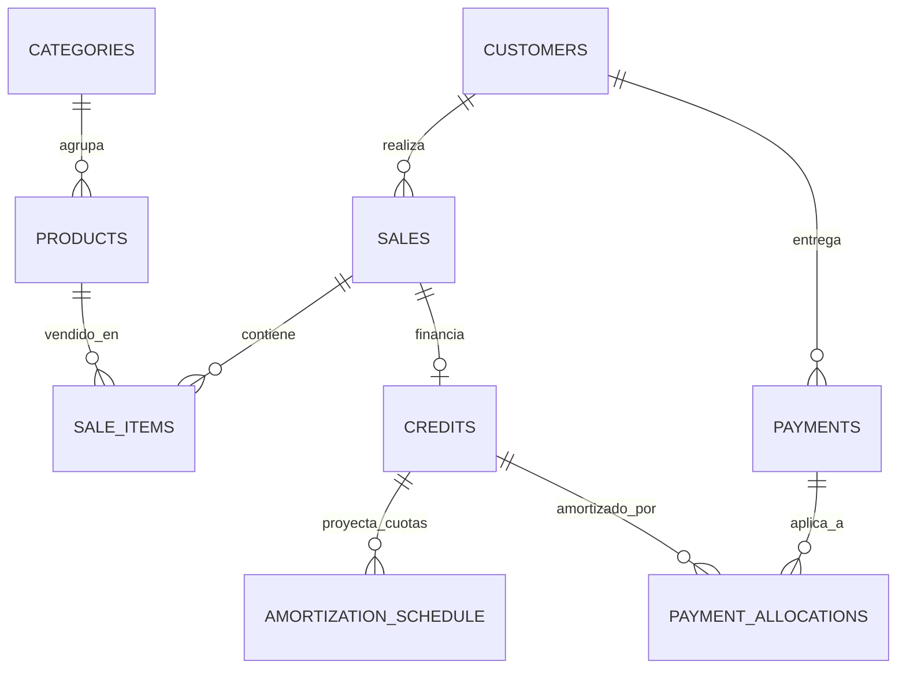

# Documento de Análisis y Diseño de Sistema

## Sistema de Gestión Comercial y Ventas al Crédito — Nicaragua

---

### 1. Resumen Ejecutivo y Enfoque Real del Negocio

Este sistema está diseñado específicamente para **un único usuario operador (el dueño)** de un negocio en Nicaragua que comercializa electrodomésticos, consolas de videojuegos (PlayStation 5, etc.), teléfonos móviles y tecnología.

#### Regla de Arquitectura Fundamental:
> **Toda la lógica y reglas de negocio residen en Procedimientos Almacenados (Stored Procedures / Funciones PL/pgSQL) dentro de Supabase / PostgreSQL.**
> El frontend (Next.js PWA) actúa como una interfaz limpia y ágil que invoca estas funciones transaccionales mediante llamadas RPC (`supabase.rpc(...)`), garantizando **atomicidad absoluta, cero discrepancias de saldo y consistencia total**.

---

### 2. Catálogo de Stored Procedures (SPs / Funciones PL/pgSQL)

Toda operación que afecte dinero, saldos, cuotas o inventario se ejecuta dentro de un SP atómico con manejo de transacciones:

| Stored Procedure (RPC) | Parámetros Principales | Responsabilidad y Reglas de Negocio que Aplica |
| :--- | :--- | :--- |
| `sp_realizar_venta_contado` | `p_customer_id`, `p_items (JSONB)`, `p_currency`, `p_payment_method` | 1. Valida stock suficiente de cada producto.<br>2. Descuenta el inventario atómicamente.<br>3. Registra la venta (`sales`) en estado `confirmed`.<br>4. Registra el pago (`payments`) por el total en la misma moneda. |
| `sp_realizar_venta_credito` | `p_customer_id`, `p_items (JSONB)`, `p_currency`, `p_down_payment`, `p_installments`, `p_frequency`, `p_first_payment_date`, `p_notes` | 1. Valida stock de productos y descuenta inventario.<br>2. Registra cabecera de venta y detalle.<br>3. Crea el crédito (`credits`) con `principal = total - down_payment`.<br>4. Si hay prima (`p_down_payment > 0`), registra el pago de prima de inmediato.<br>5. **Genera la tabla de amortización** completa en `amortization_schedule` con fechas de vencimiento y montos exactos calculados en base de datos. |
| `sp_registrar_abono` | `p_credit_id`, `p_amount`, `p_currency`, `p_payment_method`, `p_notes` | 1. Valida que el crédito esté `active` y que `currency` coincida estrictamente.<br>2. Valida que el monto no exceda el saldo pendiente total del crédito.<br>3. Registra el recibo en `payments` y crea `payment_allocations`.<br>4. **Distribuye el abono en cascada**: cancela o amortiza parcialmente las cuotas vencidas/pendientes más antiguas en `amortization_schedule`.<br>5. Si el saldo restante llega a 0, actualiza automáticamente el crédito a `paid_off`. |
| `sp_revertir_pago` | `p_payment_id`, `p_reason` | 1. Valida que el pago esté `confirmed`.<br>2. Marca el pago como `reversed`.<br>3. Reversa la amortización en las cuotas afectadas y recalcula el estado del crédito de `paid_off` a `active` si corresponde. |
| `sp_cancelar_venta` | `p_sale_id`, `p_reason` | 1. Valida que la venta esté `confirmed`.<br>2. Regresa la cantidad de productos al stock del inventario.<br>3. Cancela el crédito y sus cuotas asociadas si era al crédito.<br>4. Reversa pagos asociados con registro auditable. |
| `sp_obtener_metricas_dashboard` | *(ninguno)* | Calcula en el motor de base de datos:<br>- Total cobrado hoy y en el mes (separado por NIO y USD).<br>- Cartera total por cobrar (separada por NIO y USD).<br>- Cantidad de cuotas vencidas y próximas a vencer en los próximos 7 días.<br>- Conteo de productos con stock bajo. |

---

### 3. Modelo de Datos PostgreSQL Normalizado



#### Definición de Tablas:

```sql
-- 1. Categorías de productos
CREATE TABLE public.categories (
    id UUID PRIMARY KEY DEFAULT gen_random_uuid(),
    name TEXT NOT NULL UNIQUE,
    created_at TIMESTAMPTZ DEFAULT now() NOT NULL
);

-- 2. Catálogo de productos (Control ágil por stock numérico)
CREATE TABLE public.products (
    id UUID PRIMARY KEY DEFAULT gen_random_uuid(),
    name TEXT NOT NULL,
    category_id UUID REFERENCES public.categories(id) ON DELETE SET NULL,
    stock INTEGER NOT NULL DEFAULT 0 CHECK (stock >= 0),
    cost_price NUMERIC(14,2) NOT NULL DEFAULT 0 CHECK (cost_price >= 0),
    cost_currency VARCHAR(3) NOT NULL DEFAULT 'USD' CHECK (cost_currency IN ('NIO', 'USD')),
    cash_price NUMERIC(14,2) NOT NULL DEFAULT 0 CHECK (cash_price >= 0),
    credit_price NUMERIC(14,2) NOT NULL DEFAULT 0 CHECK (credit_price >= 0),
    sale_currency VARCHAR(3) NOT NULL DEFAULT 'USD' CHECK (sale_currency IN ('NIO', 'USD')),
    active BOOLEAN DEFAULT true NOT NULL,
    created_at TIMESTAMPTZ DEFAULT now() NOT NULL,
    updated_at TIMESTAMPTZ DEFAULT now() NOT NULL
);

-- 3. Clientes (Datos esenciales para acuerdos personales)
CREATE TABLE public.customers (
    id UUID PRIMARY KEY DEFAULT gen_random_uuid(),
    full_name TEXT NOT NULL,
    phone TEXT NOT NULL,
    alternate_phone TEXT,
    address TEXT,
    notes TEXT,
    active BOOLEAN DEFAULT true NOT NULL,
    created_at TIMESTAMPTZ DEFAULT now() NOT NULL
);

-- 4. Ventas
CREATE TABLE public.sales (
    id UUID PRIMARY KEY DEFAULT gen_random_uuid(),
    sale_number TEXT UNIQUE NOT NULL,
    customer_id UUID REFERENCES public.customers(id) ON DELETE RESTRICT,
    sale_type VARCHAR(10) NOT NULL CHECK (sale_type IN ('cash', 'credit')),
    currency VARCHAR(3) NOT NULL CHECK (currency IN ('NIO', 'USD')),
    total_amount NUMERIC(14,2) NOT NULL CHECK (total_amount > 0),
    status VARCHAR(15) NOT NULL DEFAULT 'confirmed' CHECK (status IN ('confirmed', 'cancelled')),
    notes TEXT,
    created_at TIMESTAMPTZ DEFAULT now() NOT NULL
);

-- 5. Detalle de venta
CREATE TABLE public.sale_items (
    id UUID PRIMARY KEY DEFAULT gen_random_uuid(),
    sale_id UUID NOT NULL REFERENCES public.sales(id) ON DELETE CASCADE,
    product_id UUID NOT NULL REFERENCES public.products(id) ON DELETE RESTRICT,
    quantity INTEGER NOT NULL CHECK (quantity > 0),
    unit_price NUMERIC(14,2) NOT NULL CHECK (unit_price >= 0),
    total NUMERIC(14,2) NOT NULL CHECK (total >= 0),
    created_at TIMESTAMPTZ DEFAULT now() NOT NULL
);

-- 6. Créditos acordados
CREATE TABLE public.credits (
    id UUID PRIMARY KEY DEFAULT gen_random_uuid(),
    credit_number TEXT UNIQUE NOT NULL,
    sale_id UUID UNIQUE NOT NULL REFERENCES public.sales(id) ON DELETE RESTRICT,
    customer_id UUID NOT NULL REFERENCES public.customers(id) ON DELETE RESTRICT,
    currency VARCHAR(3) NOT NULL CHECK (currency IN ('NIO', 'USD')),
    total_amount NUMERIC(14,2) NOT NULL CHECK (total_amount > 0),
    down_payment NUMERIC(14,2) NOT NULL DEFAULT 0 CHECK (down_payment >= 0),
    financed_amount NUMERIC(14,2) NOT NULL CHECK (financed_amount >= 0),
    installments_count INTEGER NOT NULL CHECK (installments_count > 0),
    frequency VARCHAR(15) NOT NULL DEFAULT 'monthly' CHECK (frequency IN ('weekly', 'biweekly', 'monthly')),
    first_payment_date DATE NOT NULL,
    status VARCHAR(15) NOT NULL DEFAULT 'active' CHECK (status IN ('active', 'paid_off', 'cancelled')),
    notes TEXT,
    created_at TIMESTAMPTZ DEFAULT now() NOT NULL
);

-- 7. Tabla de amortización de cuotas pactadas
CREATE TABLE public.amortization_schedule (
    id UUID PRIMARY KEY DEFAULT gen_random_uuid(),
    credit_id UUID NOT NULL REFERENCES public.credits(id) ON DELETE CASCADE,
    installment_number INTEGER NOT NULL CHECK (installment_number > 0),
    due_date DATE NOT NULL,
    expected_amount NUMERIC(14,2) NOT NULL CHECK (expected_amount > 0),
    paid_amount NUMERIC(14,2) NOT NULL DEFAULT 0 CHECK (paid_amount >= 0),
    status VARCHAR(15) NOT NULL DEFAULT 'pending' CHECK (status IN ('pending', 'partial', 'paid', 'overdue')),
    created_at TIMESTAMPTZ DEFAULT now() NOT NULL,
    CONSTRAINT unique_credit_installment UNIQUE (credit_id, installment_number)
);

-- 8. Pagos y recibos
CREATE TABLE public.payments (
    id UUID PRIMARY KEY DEFAULT gen_random_uuid(),
    payment_number TEXT UNIQUE NOT NULL,
    customer_id UUID NOT NULL REFERENCES public.customers(id) ON DELETE RESTRICT,
    credit_id UUID REFERENCES public.credits(id) ON DELETE RESTRICT,
    amount NUMERIC(14,2) NOT NULL CHECK (amount > 0),
    currency VARCHAR(3) NOT NULL CHECK (currency IN ('NIO', 'USD')),
    paid_at TIMESTAMPTZ DEFAULT now() NOT NULL,
    payment_method VARCHAR(20) NOT NULL DEFAULT 'cash' CHECK (payment_method IN ('cash', 'transfer', 'other')),
    notes TEXT,
    status VARCHAR(15) NOT NULL DEFAULT 'confirmed' CHECK (status IN ('confirmed', 'reversed')),
    created_at TIMESTAMPTZ DEFAULT now() NOT NULL
);

-- 9. Asignación de pagos a créditos
CREATE TABLE public.payment_allocations (
    id UUID PRIMARY KEY DEFAULT gen_random_uuid(),
    payment_id UUID NOT NULL REFERENCES public.payments(id) ON DELETE RESTRICT,
    credit_id UUID NOT NULL REFERENCES public.credits(id) ON DELETE RESTRICT,
    amount NUMERIC(14,2) NOT NULL CHECK (amount > 0),
    created_at TIMESTAMPTZ DEFAULT now() NOT NULL
);
```

---

### 4. Algoritmo de Amortización y Cascada de Abonos en SQL

Cuando se llama a `sp_realizar_venta_credito`:
1. El SP calcula el monto por cuota con división exacta:
   $$\text{Monto Base} = \text{ROUND}(\text{financed\_amount} / \text{installments\_count}, 2)$$
2. El residuo de redondeo se suma a la última cuota para que la sumatoria sea **100% exacta al centavo**.
3. Las fechas se calculan usando aritmética de intervalos de PostgreSQL (`due_date = p_first_payment_date + (i * interval '1 month')`).

Cuando se llama a `sp_registrar_abono`:
1. El monto recibido se itera sobre las cuotas pendientes ordenadas por `due_date ASC`.
2. Para cada cuota:
   - Se cubre lo adeudado (`expected_amount - paid_amount`).
   - Si se cubre todo, pasa a `status = 'paid'`.
   - Si se cubre parcialmente, pasa a `status = 'partial'`.
   - El sobrante del abono pasa a la siguiente cuota.
3. Si todas las cuotas quedan en `paid`, el crédito pasa a `paid_off`.

---

### 5. Adaptador Frontend Dual (Demo Offline / Supabase RPC)

En el frontend tendremos un servicio unificado:
- En **Modo Demo**: Un simulador ejecuta exactamente la misma lógica de los Stored Procedures en memoria/LocalStorage (para probar inmediatamente sin necesidad de configurar base de datos externa).
- En **Modo Producción Supabase**: Ejecuta llamadas directas `supabase.rpc('sp_realizar_venta_credito', { ... })`.

Esto permite entregar una demo 100% funcional y al mismo tiempo dejar el archivo SQL de migraciones listo para ser ejecutado en el SQL Editor de Supabase con un solo clic.
